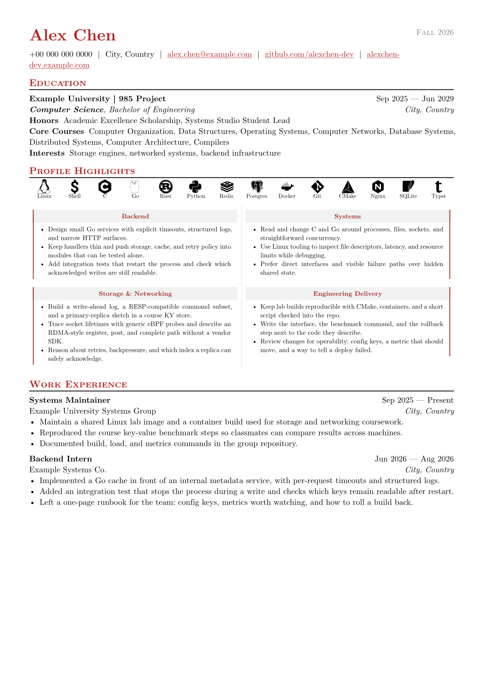
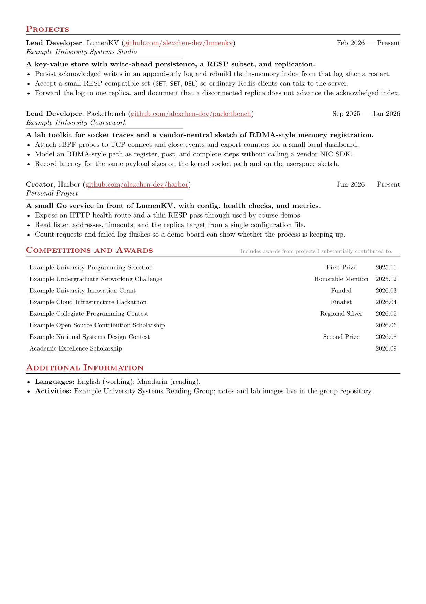

# Typst 简历模板

两页英文简历，用 [Typst](https://typst.app/) 编写。示例是虚构的后端与基础设施学生，不是真人，不含真实个人信息。

A two-page English resume written in [Typst](https://typst.app/). The sample is a fictional backend and infrastructure student — not a real person, and no real personal data.

## 预览 / Preview





## 编译 / Build

安装 [Typst](https://typst.app/) 后：

```sh
typst compile resume.typ
```

PDF 已列入 `.gitignore`，不会提交。技能图标使用 [Hack Nerd Font](https://www.nerdfonts.com/)；未安装时图标会显示为方框。缺少该字体或 KaiTi 的警告可以忽略。

The PDF is gitignored. Skill icons use [Hack Nerd Font](https://www.nerdfonts.com/); without it they render as boxes. Warnings about that font or KaiTi are safe to ignore.

## 修改 / Customize

- `resume.typ` — 姓名、联系方式、教育、经历、项目 / name, contact, education, experience, projects
- `awards.yaml` — 奖项。日期请写成 `"2026.05"` 这样的字符串，避免被 Typst 读成小数 / awards; quote dates so Typst does not parse them as floats
- 图标是 Nerd Font 字形，仓库不含 `img/` / icons are Nerd Font glyphs; this repo has no `img/` directory

换成自己的内容后、公开前再检查一遍，去掉不想公开的电话、邮箱和其他标识。

After you add your own details, review the repository before publishing and remove phone numbers, emails, or other identifiers you do not want public.

## 许可 / License

[MIT](LICENSE)
